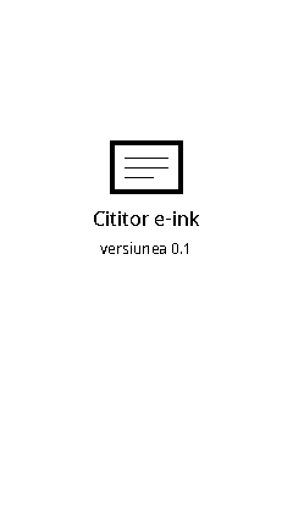
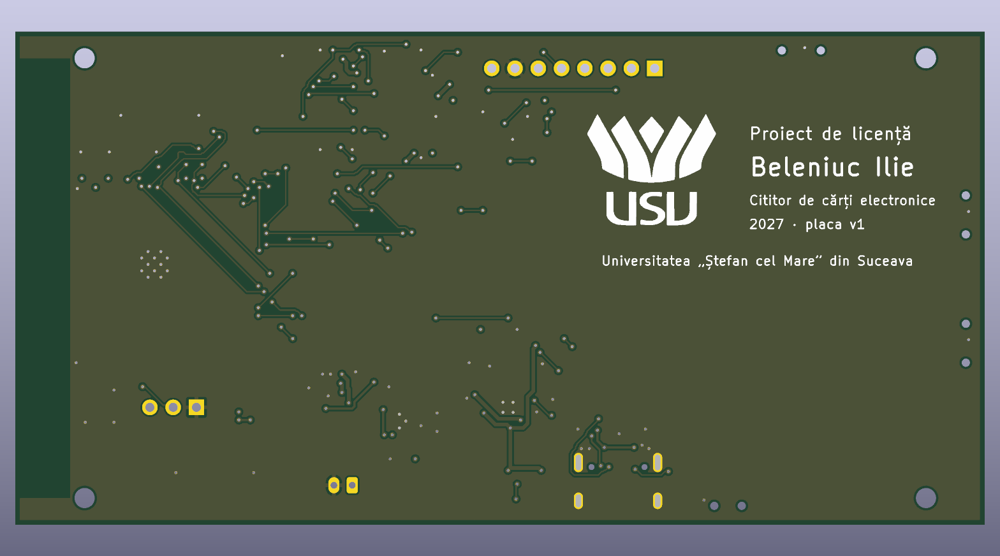

# Cititor de cărți electronice cu e-ink

Proiect de licență, Universitatea „Ștefan cel Mare” din Suceava. Beleniuc Ilie, 2027.

Un cititor de cărți electronice cu ecran e-ink de 3,7″ și ESP32-S3, cu firmware
propriu, un format de carte propriu și placa lui proprie.

## Ce e aici

| dosar | ce e |
|---|---|
| [`firmware/`](firmware/) | firmware-ul ESP-IDF: driverul panoului, cardul, butoanele, managerul de aplicații, cititorul, somnul |
| [`spec/`](spec/) | formatul de carte (`.ibv`) și formatul de font (`.ibf`) |
| [`tools/`](tools/) | convertorul EPUB / FB2 / TXT → `.ibv`, unealta de fonturi, comparația cu TeX, fuzzerele |
| [`sim/`](sim/) | simulatorul pe PC, cu testele cu imagini de referință |
| [`emu/`](emu/) | emulatorul: firmware-ul adevărat pe un ESP32-S3 emulat (QEMU) |
| [`hardware/`](hardware/) | schema prototipului, desenul plăcii de prototipare (`proto/`) și placa proprie (`pcb/`) |
| [`measurements/`](measurements/) | experimentele: fișele de metodă, datele, figurile și rezultatele (E5 și E6 rulate până acum) |
| [`docs/`](docs/) | planul general, descrierea proiectului și jurnalul |

Planul, cu ce e gata și ce urmează: [`docs/MASTER-PLAN.md`](docs/MASTER-PLAN.md).
Jurnalul: [`docs/README.md`](docs/README.md).

## Unde e

Firmware-ul se compilează și rulează în emulator și în simulator. Încă n-a rulat
pe hardware: prototipul nu e lipit. Placa proprie e o ciornă, nerevizuită și
necomandată.
