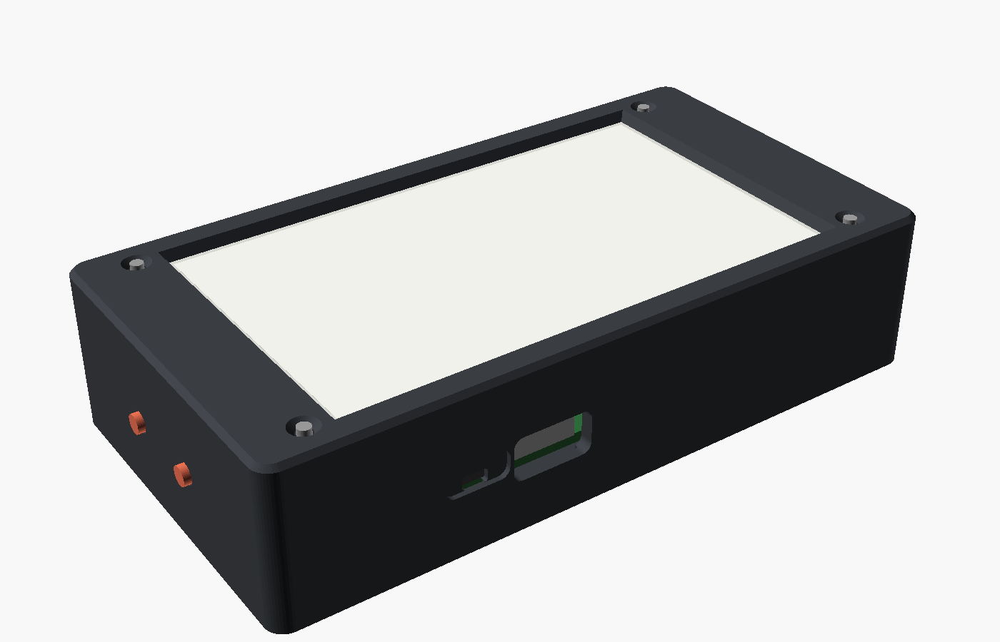
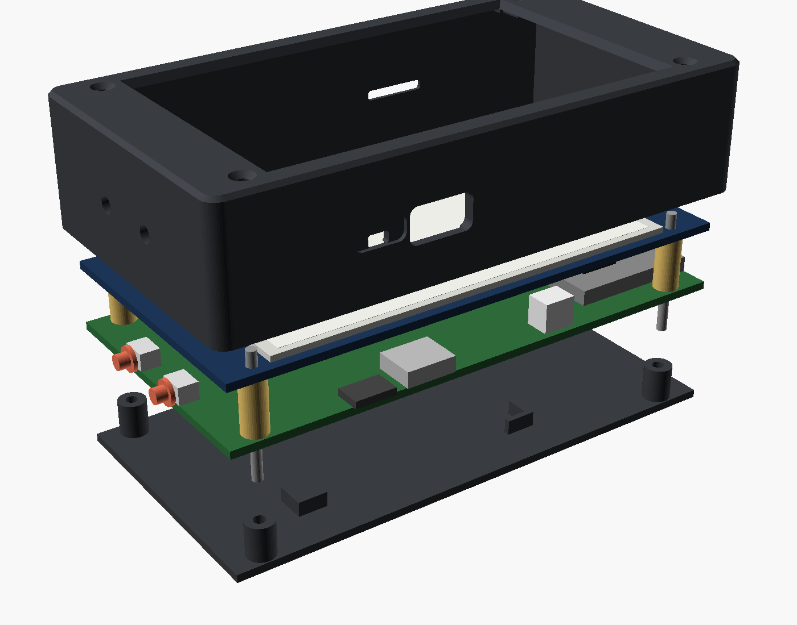
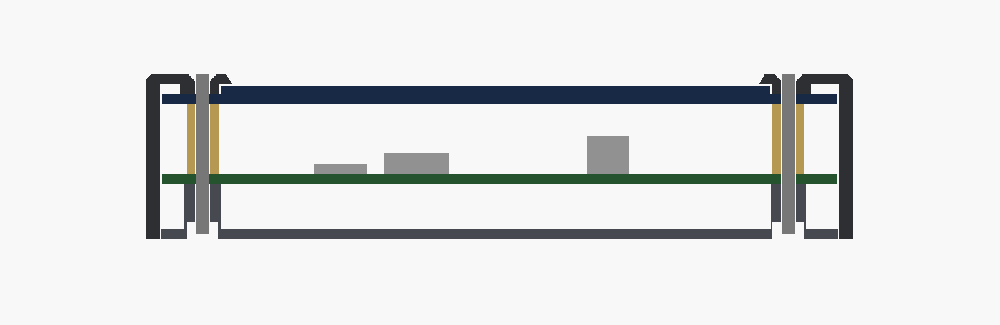
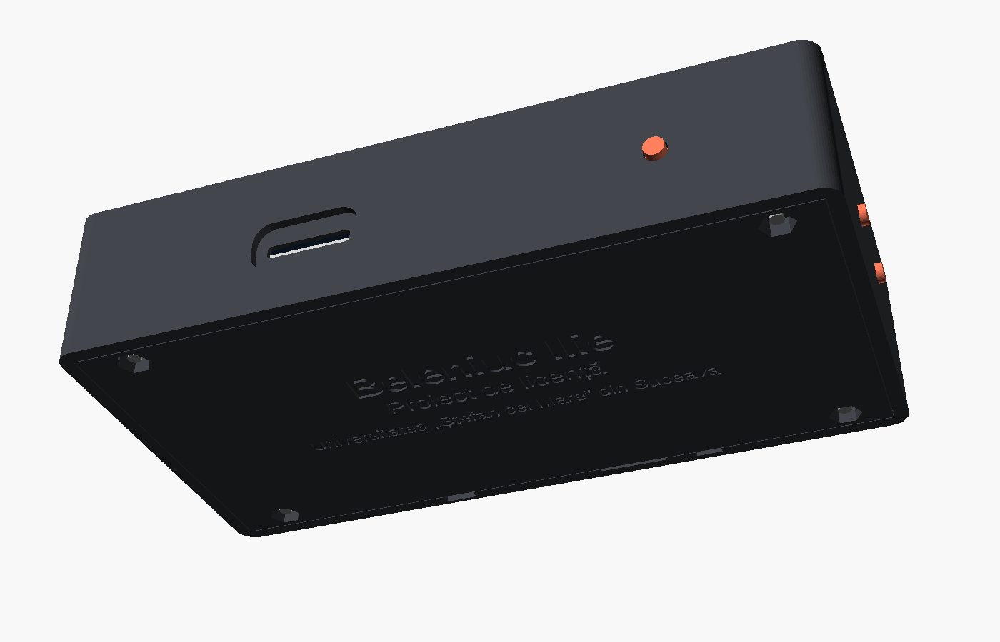

# Carcasa (ENC-1), ciornă

Carcasă printată pentru placa proprie v1 și ecranul WeAct de 3,7". E parametrică (OpenSCAD).
Geometria plăcii vine direct din fișierul KiCad, deci carcasa urmează placa când se mută o piesă.



Nimic nu e printat încă. Cotele panoului, ale plăcii WeAct, ale baretei dintre plăci și ale bateriei sunt **estimate**: lista e mai jos, la „De măsurat”. Până nu sunt măsurate, primul print e o probă de potrivire (ENC-3), nu carcasa finală.

## Ce e

| Piesa | Buc. | Ce face | Cum se printează |
|---|---|---|---|
| `fata` | 1 | rama cu fereastra și toți pereții; în ei, gurile pentru USB-C, microSD, comutator și butoane | cu fața pe masă |
| `spate` | 1 | capacul; are stâlpii pentru placă, colțarele bateriei și locașurile piulițelor | cu fața exterioară pe masă |
| `buton` | 3 | împingătorul unui buton lateral; flanșa lui stă într-un locaș din perete, deci nu cade | cu flanșa pe masă |
| `distantier` | 4 | tub între placa noastră și placa WeAct, cât bareta dintre ele | în picioare |

Se mai cumpără: 4 șuruburi **M2×25 cu cap înecat** (ISO 7046 / DIN 965) și 4 piulițe M2. Lungimea o alege `carcasa.scad` din lungimile standard, după grosimea stivei; o afișează `make.sh`.

Dimensiuni cu valorile de acum: **110,8 × 58,8 × 25,8 mm**.



### Stiva, din spate spre față

Secțiune prin găurile H3/H4 (Y = 2,9 mm), cu șuruburile:



1. capacul (1,6 mm), cu stâlpii de 7 mm și piulițele în locașuri hexagonale pe fața exterioară;
2. bateria, între capac și spatele plăcii (pe fața B nu sunt piese, doar sigla și pinii pieselor THT);
3. placa noastră (1,6 mm), cu piesele spre ecran;
4. distanțierele de 11 mm, cât soclul mamă de 8,5 mm plus plasticul baretei tată de 2,5 mm;
5. placa WeAct și panoul, apăsate de ramă în cele patru colțuri, pe lângă sticlă;
6. rama (1,6 mm), cu capetele șuruburilor înecate în colțuri.

Cele patru șuruburi strâng tot pachetul între ramă și capac, deci carcasa nu are cleme. Grosimea vine mai ales din spațiul de 11 mm dintre plăci. Acolo cele mai înalte piese sunt J5 (UART, 8,5 mm) și fișa bateriei în J2 (~9,5 mm, estimat). O placă v2 cu un soclu mai jos, fără J5 și cu un conector de baterie orizontal ar coborî stiva la ~5 mm și carcasa la ~20 mm.

### Pe margini

- **Jos**: USB-C (gura e cât capătul turnat al cablului, 12,8 × 7 mm) și comutatorul pornit/oprit. Maneta comutatorului ajunge la nivelul peretelui, într-o adâncitură; se mută cu unghia.
- **Sus**: fanta microSD, cu o adâncitură pentru deget, și butonul MENIU.
- **Stânga**: ÎNAPOI (sus) și ÎNAINTE (jos).
- **Dreapta**: nimic. Acolo e antena modulului WiFi. Cel mai aproape metal sunt șuruburile H2/H4, la ~15 mm de antenă. Dacă WiFi-ul suferă, acolo se pun șuruburi de nailon.
- BOOT și RESET (SW5, SW6) nu se văd din afară. Scrierea în flash merge de obicei prin USB-C fără ele; dacă firmware-ul blochează USB-ul, se desface capacul.

Sub USB-C, sub comutator și la firul bateriei, peretele are canale pe interior: pe acolo trec piesele care ies peste marginea plăcii când pachetul intră pe la spate.



## Cum se refac fișierele

```sh
enclosure/make.sh               # tot (~1 min)
enclosure/make.sh --fara-kicad  # fără KiCad: folosește placa.scad din git
```

- `placa.py` citește `hardware/pcb/eink-reader-pcb.kicad_pcb` (API-ul pcbnew din KiCad 10). Scoate conturul, găurile și pozițiile pieselor de pe margini și scrie `placa.scad`. Acesta e în git, deci carcasa se deschide și fără KiCad.
- `carcasa.scad` e modelul. Toate cotele sunt parametri la început. `piesa = ...` alege ce se desenează: `ansamblu`, `explodat`, `sectiune`, `fata`, `spate`, `buton`, `distantier` sau `print` (toate piesele așezate pe masă).
- Ieșirile: `stl/` (piesele de printat, neurmărite în git) și `img/` (imaginile de aici).
- Merge cu OpenSCAD 2021.01 (cel din flatpak) și cu versiunile noi. Pentru imagini e nevoie de un ecran X; pe Wayland merge prin Xwayland.

### Ce verifică

- Fiecare piesă de printat iese un singur corp închis (CGAL: `Simple: yes`, un volum).
- Șurubul: există o lungime standard care nu iese prin capac. Locașul piuliței nu trece prin stâlp.
- Avertismente („ATENȚIE”), afișate la sfârșit:
  - un colț de apăsare al ramei cade pe sticla panoului;
  - fereastra iese din sticlă;
  - o piesă înaltă nu încape între plăci;
  - bateria ajunge sub modulul WiFi sau se lovește de un stâlp.

## Montajul

1. Piulițele în locașurile din capac, împingătoarele în pereți, din interior, cu flanșa în locaș.
2. Rama cu fața în jos. În ea, placa WeAct cu panoul în jos, apoi distanțierele pe găuri.
3. Fișa bateriei în J2, înainte de a pune placa noastră: J2 e pe fața dinspre ecran.
4. Placa noastră, cu piesele în jos, pe distanțiere. Firul bateriei trece pe lângă marginea de jos, prin canalul de lângă J2.
5. Bateria pe spatele plăcii, între colțarele capacului. Pe pinii THT de sub ea se pune o bandă izolatoare.
6. Capacul. Șuruburile intră din față, prin colțurile ramei, și se strâng în piulițe.

## De măsurat

Valorile de mai jos sunt estimate. Se măsoară cu șublerul și se trec în `carcasa.scad`; `make.sh` spune apoi dacă tot mai încape.

| Ce | Acum | Parametrul | Ce schimbă |
|---|---|---|---|
| sticla panoului: lungime, lățime, unde e față de găuri | 86 × 50 mm, centrată între găuri | `panou`, `panou_c` | colțurile de apăsare |
| zona activă: mărime și centru | 81,40 × 46,96 mm, din diagonală; centrată | `activ`, `activ_c` | fereastra |
| grosimea panoului și a plăcii WeAct | 1,2 și 1,6 mm | `panou_t`, `weact_t` | cât apasă rama pe sticlă |
| bareta dintre plăci: soclul și pinii, adică distanța dintre fețele plăcilor | 11 mm (FIRE.md, punctul 1) | `stiva` | distanțierele, grosimea |
| piesele de pe spatele plăcii WeAct, lângă găuri | — | — | dacă încap distanțierele de Ø5 mm |
| pe ce latură se îndoaie cablul panoului (FPC) și cât iese peste placă | — | `clr` | jocul față de pereți |
| bateria: lungime, lățime, grosime, pe unde iese firul | 50 × 34 × 6 mm (presupusă) | `bat`, `bat_c` | colțarele, `gol_spate`, grosimea |
| fișa bateriei în J2: înălțimea cu firul îndoit | ~9,5 mm | `inalte` | dacă încape între plăci |
| cât ies pârghiile butoanelor și maneta comutatorului peste margine | după amprentele KiCad | `btn_z`, `sw1_z`, `buton_lacas` | împingătoarele, fanta |
| înălțimea gurii USB-C și a slotului microSD peste placă | din foile de catalog | `usb_z`, `sd_z` | gurile din pereți |

## Ce nu e încă

- Nu e printată (ENC-2) și nu s-a probat pe piese (ENC-3).
- Cotele din „De măsurat” nu sunt verificate. Placa noastră e și ea o ciornă nerevizuită (`hardware/pcb`), deci carcasa se reface după orice schimbare a ei: rulezi `make.sh`.
- Jocurile (0,3 mm la pereți, 0,2 mm la găurile butoanelor) sunt valori obișnuite pentru FDM, nealese pe o imprimantă anume.
