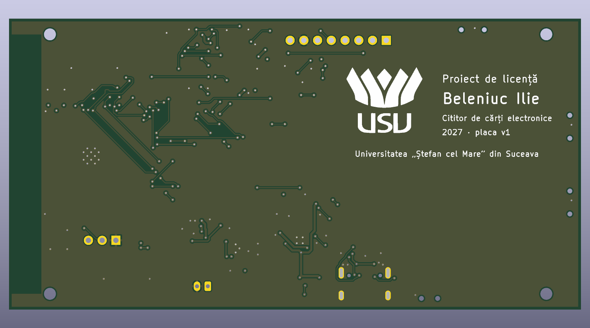

# Placa proprie v1 (CIORNĂ)

Placa cititorului care înlocuiește DevKit-ul și firele de pe masă: ESP32-S3,
încărcarea LiPo din USB-C, 3,3 V cu consum mic în somn, cardul și afișajul cu
alimentare comutată, trei butoane. Totul e **generat din script**: piesele și
legăturile sunt scrise o dată în `circuit.py`, din care ies schema, placa așezată
și trasată, verificările și fișierele pentru fabrică.

**E o ciornă.** Are revizia pe hârtie încheiată (PCB-4, [`REVIEW.md`](REVIEW.md));
nu s-a comandat. Codurile LCSC sunt verificate în catalog (PCB-5, mai jos); rotațiile și originile din `cpl.csv` sunt calculate din amprentele EasyEDA, dar nu sunt încă văzute în previzualizarea JLCPCB. Pașii PCB-1…3 din `docs/MASTER-PLAN.md` au acum o
primă variantă completă, cu trei luni înainte de calendar; prototipul de pe
DevKit rămâne referința până la măsurători.

## Cum se rulează

    hardware/pcb/make.sh                  # tot, ~2 min
    hardware/pcb/make.sh --fara-trasare   # doar verificările, fab/ și imaginile

Are nevoie de KiCad 10 (`kicad-cli` și modulul Python `pcbnew`), `cc` și `zip`.
`make.sh` se oprește dacă ERC-ul sau DRC-ul are vreo eroare, vreo legătură lipsă
sau vreo diferență între schemă și placă.

| fișier | ce face |
|---|---|
| `circuit.py` | sursa unică: piesele, valorile, amprentele, pinii pe rețele, codurile LCSC/MPN |
| `gen_sch.py` | schema `eink-reader-pcb.kicad_sch`, grupată pe blocuri, cu etichete globale |
| `gen_pcb.py` | placa: conturul, așezarea, rețelele, planurile, trasarea, umplerea zonelor |
| `route.py`, `astar.c` | trasorul (mai jos) |
| `project.py` | `.kicad_pro`: clasele de rețele și regulile |
| `eink-reader-pcb.kicad_dru` | regulile în plus (găurile butoanelor și ale mufei USB, traseele de putere) |
| `marking.py`, `usv_sigla.json` | serigrafia de pe spate: sigla USV și numele proiectului (mai jos) |
| `verifica.py` | regulile de proiectare pe care ERC/DRC nu le au: pinii ESP32-S3, polaritatea, decuplarea, antena, pinii din firmware (`--pini`: tabelul pin → rețea) |
| `REVIEW.md` | revizia PCB-4: fiecare bloc față de foaia lui de catalog, plus ce rămâne de hotărât |
| `jlc_rotatii.py`, `jlc_corectii.csv` | corecțiile de rotație și origine pentru CPL, din amprentele EasyEDA (vezi „Comanda”) |
| `make.sh` | tot lanțul, cu verificările |

Ies: `build/` (rapoartele ERC/DRC în JSON, poziții, BOM brut, `cupru.svg`),
`fab/` (gerbere + găuri în `gerber.zip`, `bom.csv` și `cpl.csv` în formatul
JLCPCB) și `img/`. `build/` și `fab/` nu intră în git; se refac oricând.

Schema și placa se deschid normal în KiCad, dar **nu se editează de mână**: o
schimbare se face în `circuit.py` sau în așezarea din `gen_pcb.py` și se rulează
din nou `make.sh`.

## Placa

- 105,79 × 53,80 mm, exact placa modulului de afișaj WeAct de 3,7 țoli, cu
  găurile de M2 în aceleași locuri: cele două stau spate în spate, cu
  distanțiere.
- 4 straturi (procesul JLCPCB): F.Cu semnale, In1.Cu plan GND întreg, In2.Cu
  plan +3V3, B.Cu semnale. Pe F.Cu și B.Cu, GND turnat în rest.
- Trasee și spații de 0,15 mm (procesul permite 0,1), via 0,6/0,3 mm.
  Rețelele de putere (VBUS, VSYS, VBAT, BAT_J, LX1, LX2, 3V3_SD, 3V3_EPD) au
  0,4 mm, cu 0,25 mm admis unde nu încape altfel (mai jos).
- Antena modulului ESP32 e pe marginea din dreapta; pe ultimii 6 mm ai plăcii
  (zona interzisă din amprenta modulului) nu e cupru pe niciun strat.

## Serigrafia

Pe spate (B.SilkS), fața fără piese: sigla Universității „Ștefan cel Mare” din
Suceava, „Proiect de licență”, numele, titlul și „2027 · placa v1”. Sigla e cea
de pe usv.ro, vectorizată cu potrace în `usv_sigla.json`. `marking.py` o pune
într-un grup care se înlocuiește la fiecare rulare (`python3 marking.py` merge și
pe placa deja trasată) și se oprește dacă ceva atinge o pastilă, o gaură sau o via.
Pe față nu e serigrafie în afară de contururile amprentelor: numele pieselor
stau pe F.Fab.

## Piesele

Codurile LCSC sunt verificate în catalogul JLCPCB (secțiunea „Comanda”);
fără cod au rămas doar baretele J3 și J5, care se lipesc de mână.

| bloc | piese | de ce |
|---|---|---|
| USB-C | J1 GCT USB4105, R1/R2 5,1 kΩ pe CC, U1 USBLC6-2SC6 (LCSC C7519), R17/R18 470 kΩ divizor VBUS → IO2 cu C17 100 nF, R25/R26 22 Ω serie pe D+/D− lângă modul | 5 V de la orice încărcător C; ESD pe D+/D−; firmware-ul vede când e cablul pus |
| încărcătorul | U2 BQ24074 (VQFN-16), R3 3,3 kΩ (ILIM ≈ 0,47 A), R4 1,8 kΩ (ICHG ≈ 0,5 A), R5 10 kΩ pe TS, D1/D2 PGOOD/CHG | power-path: dispozitivul merge din USB cu bateria goală; EN1/EN2 legați pentru USB500 |
| bateria | J2 JST-PH 2 pini, JP1 punte de lipit (I_BAT), U6 MAX17048 (indicator ModelGauge, I2C), R15/R16 1 MΩ divizor VBAT → IO1 | JP1 tăiată = un ampermetru în serie cu bateria, pentru E3/E4 |
| 3,3 V | SW1 PCM12 (comutator pornit/oprit pe EN), U3 TPS63900 buck-boost, L1 2,2 µH, R8/R9 configurarea | 75 nA în gol și buck-boost: 3,3 V stabil de la 4,2 V până la 2,5 V din baterie |
| comutatoare de sarcină | U4/U5 TPS22917 pentru card (3V3_SD) și afișaj (3V3_EPD), C7/C8 1 nF urcare lentă, R10/R11 1 MΩ pe EN | cardul și panoul nu consumă nimic în somn |
| MCU | U7 ESP32-S3-WROOM-1-N16R8 (C2913202), RC pe EN, SW5 BOOT, SW6 RESET, J5 UART0 | același modul ca pe DevKit, deci aceeași hartă de pini |
| butoane | SW2–SW4 Alps SKRTLAE010 (C110293), pe margini (două pe stânga, MENIU sus), apăsate din lateral | ÎNAPOI, ÎNAINTE, MENIU |
| afișaj | J3 baretă 1×8 de 2,54 mm spre modulul WeAct | BUSY, RST, DC, CS, SCK, MOSI, GND, 3V3_EPD; SCK și MOSI sunt ale lui, nu le împarte cu cardul |
| card | J4 Molex 104031 microSD, R21–R24 47 kΩ | modul SPI; pull-up pe CS, MISO și DAT1/DAT2 |
| test | TP1–TP8: VBUS, VSYS, BAT_J, VBAT, +3V3, GND, 3V3_SD, 3V3_EPD | pentru punerea în funcțiune și măsurători, într-un singur rând |

GPIO-urile păstrează harta de pe DevKit (`firmware/boards/include/board_devkit.h`); antetul plăcii
e `firmware/boards/include/board_pcb_v1.h`, verificat de `verifica.py`. În plus față de DevKit:
I2C pe IO16 (SDA) și IO17 (SCL), FG_ALRT pe IO7, SD_PWR_EN pe IO15,
EPD_PWR_EN pe IO21, VBUS_SENSE pe IO2. Singura diferență: pe DevKit cardul și
panoul împart bus-ul SPI (IO11/12/13); aici bus-ul acela rămâne cardului, iar
panoul are SCK pe IO47 și MOSI pe IO48. Pe N16R8 IO47/IO48 sunt pini obișnuiți
de 3,3 V (doar modulele R16V îi au de 1,8 V).

## Consumul în somn (estimat)

| piesa | curent |
|---|---:|
| ESP32-S3 în somn adânc, cu temporizatorul RTC | ~8 µA |
| BQ24074, din baterie, fără USB | 4,3 µA |
| MAX17048 în hibernare | 3 µA |
| divizorul VBAT (2 MΩ la ~4 V) | 2,1 µA |
| TPS63900 în gol | ~0,1 µA |
| cardul și afișajul (comutatoarele oprite) | ~0 |
| **total** | **~17,5 µA** |

Cifrele sunt din foile de catalog (tipice). Cu o baterie de 1500 mAh, somnul
singur ar ține ani; consumul real e dat de paginile întoarse și se măsoară la
E3/E4, cu JP1 tăiată.

## Trasorul

KiCad nu are un trasor automat, iar FreeRouting cere Java și o rundă de
import/export. `route.py` e un trasor propriu, pe grilă, cu căutarea în C
(`astar.c`, prin ctypes):

- Grilă de 0,125 mm pe F.Cu și B.Cu, câte o matrice pe clasă de lățime (0,15 / 0,25 / 0,4 mm, via). Pentru fiecare rețea, cuprul celorlalte e
  umflat cu jumătatea lățimii pistei plus distanța minimă și scos din grilă,
  deci ce găsește A* respectă DRC-ul prin construcție.
- A* cu euristică octilă, via cu cost, B.Cu puțin mai scump (rămâne loc pentru turnarea GND). O rețea
  cu mai mulți pini crește ca un arbore: fiecare pin nou caută cel mai apropiat
  punct al arborelui de până acum.
- Pinii SMD de pe GND și +3V3 primesc o scurtă ieșire spre o via în planul lor.
- **Smulgere și retrasare** (în felul PathFinder): după 6 treceri complete în
  ordini diferite, o rețea care nu încape se caută din nou „moale”, având voie
  să treacă peste cuprul altora cu un cost mare. Rețelele atinse de drumul găsit
  se smulg, ea se trasează, apoi ele se retrasează. Celulele disputate primesc
  un cost istoric care crește, ca rețelele să nu se smulgă una pe alta la
  nesfârșit.

Rezultatul, pe placa de acum: **52 din 52 de rețele trasate**, 0 ieșiri spre
plan eșuate, după 14 smulgeri. 1.022 de segmente, 1.469,3 mm de pistă, 206 via.

## Verificările

`make.sh`, pe placa din git:

- ERC: 0.
- DRC (regulile din `.kicad_pro` și `.kicad_dru`, cu zonele reumplute): 0
  erori, 0 legături lipsă, 0 diferențe între schemă și placă.
- 4 avertismente `lib_footprint_mismatch` (U2, U3, U7, SW1): amprentele diferă
  de biblioteca KiCad dinadins. La U2 și U3 viaurile termice din padul central
  sunt mărite la găuri de 0,3 mm (minimul fabricii) și rărite. La U7 curtea e
  tăiată la marginea plăcii, unde iese antena. La SW1 serigrafia de peste
  margine e scoasă.

Pistele de putere de 0,25 mm (unde 0,4 nu încape):

| rețea | lățime | lungime | curent |
|---|---|---:|---|
| LX2 | 0,25 mm | 4,6 mm | nodul de comutație al TPS63900, sub 0,5 A |
| VBUS | 0,25 mm | 71,1 mm | de la J1 la U2, U1, R17 și TP1: curentul de intrare al încărcătorului, ≤ 0,5 A (modul USB500), ~0,14 Ω, deci ~70 mV cădere din cei 5 V |

O pistă de 0,25 mm în cupru de 1 oz duce ~1 A la o încălzire de 10 °C, deci
are rezervă de două ori. Celelalte rețele de putere sunt de 0,4 mm: VSYS
58,6 mm, 3V3_EPD 31,8 mm, 3V3_SD 42,8 mm, BAT_J 13,8 mm, LX1 1,7 mm, VBAT 51,9 mm.

## De știut înainte de comandă

- **Poziția baretei J3** e luată din desenul modulului WeAct. Se măsoară pe
  modulul adevărat înainte de comandă.
- **Polaritatea JST** nu e standard: pinul 1 e plusul aici, dar cablurile
  bateriilor vin în ambele feluri. Se verifică cu multimetrul înainte de prima
  conectare.
- **Alimentarea inversă**: înainte de a opri 3V3_SD sau 3V3_EPD, firmware-ul
  trebuie să pună liniile SPI și CS-urile pe 0, altfel cardul sau panoul se
  alimentează prin diodele de protecție ale pinilor. O face `board_power_off()`
  din `firmware/main/board_io.c` (PCB-8), netestat pe placă. Cum fiecare are bus-ul lui, liniile unuia se pun
  pe 0 fără să-l încurce pe celălalt (`REVIEW.md`, punctul 1).
- **TPS63900 la vârfurile de WiFi**: dă până la ~400 mA; ESP32-S3 cere vârfuri
  de ~350 mA la transmisie. Merge cu C5 + C14 (2 × 22 µF), dar fără rezervă.
  Hotărât (`REVIEW.md`, punctul 4): firmware-ul limitează emisia la 13 dBm și
  pornește WiFi-ul doar cu panoul și cardul inactive. Cititorul nu are încă
  WiFi; vârfurile se măsoară pe placă.
- **Decuparea sub antenă** e amânată până la măsurătoarea de semnal din
  carcasă (ENC-3; `REVIEW.md`, punctul 3).
- **TS cu rezistor fix**: R5 îi spune încărcătorului că bateria are mereu
  25 °C, deci nu oprește încărcarea la cald sau la rece. Bateria trebuie să aibă
  protecția ei (PCM), ca toate celulele LiPo din comerț.
- **R8/R9** sunt verificate în tabelele 7-2/7-3 ale foii TPS63900 (`REVIEW.md`).
- Contactul de detecție al cardului (J4) nu e folosit.
- J2, J3, J5 sunt cu găuri (THT); SW2–SW4 și J1 au picioare de fixare în găuri
  nemetalizate, cu reguli de distanță proprii în `.kicad_dru`.
- Etichetele pieselor sunt pe F.Fab, nu pe serigrafie: placa e plină, iar
  pozițiile se văd în `build/cupru.svg`.
- **Rotațiile din `cpl.csv`** sunt calculate, nu confirmate în previzualizare: vezi „Comanda”.

## Comanda (PCB-5)

Codurile din `circuit.py` sunt verificate pe 2026-11-19 în catalogul de
asamblare JLCPCB: modelul, capsula și stocul fiecăruia. Stocul e cel din acea zi
și se schimbă. „Necesar” înseamnă 5 plăci, fără pierderile de la montaj.

| Piese | LCSC | Model | Tip | Stoc | Necesar |
|---|---|---|---|---:|---:|
| C1, C16 | C15849 | Samsung CL10A105KB8NNNC, 1 µF 50 V X5R | de bază | 12.258.861 | 10 |
| C2, C3 | C19666 | Samsung CL10A475KO8NNNC, 4,7 µF 16 V X5R | de bază | 3.307.574 | 10 |
| C4, C9, C11 | C19702 | Samsung CL10A106KP8NNNC, 10 µF 10 V X5R | de bază | 10.685.497 | 15 |
| C5, C14 | C59461 | Samsung CL10A226MQ8NRNC, 22 µF 6,3 V X5R | de bază | 5.997.547 | 10 |
| C7, C8 | C1588 | Samsung CL10B102KB8NNNC, 1 nF 50 V X7R | de bază | 5.287.619 | 10 |
| C10, C12, C13, C15, C17 | C14663 | YAGEO CC0603KRX7R9BB104, 100 nF 50 V X7R | de bază | 53.069.967 | 25 |
| D1 | C12624 | KENTO KT-0603G, verde | extinsă | 208.308 | 5 |
| D2 | C111340 | KENTO KT-0603O, portocaliu | extinsă | 16.346 | 5 |
| J1 | C3020560 | GCT USB4105-GF-A | extinsă | 13.662 | 5 |
| J2 | C131337 | JST B2B-PH-K-S (THT) | extinsă | 273.875 | 5 |
| J4 | C585350 | Molex 104031-0811 | extinsă | 46.266 | 5 |
| L1 | C488330 | Murata DFE252010F-2R2M | extinsă | 4.113 | 5 |
| R1, R2 | C23186 | UNI-ROYAL 0603WAF5101T5E, 5,1 kΩ | de bază | 18.766.089 | 10 |
| R3 | C22978 | UNI-ROYAL 0603WAF3301T5E, 3,3 kΩ | de bază | 4.161.647 | 5 |
| R4 | C4177 | UNI-ROYAL 0603WAF1801T5E, 1,8 kΩ | de bază | 479.075 | 5 |
| R5, R19, R20 | C25804 | UNI-ROYAL 0603WAF1002T5E, 10 kΩ | de bază | 43.980.846 | 15 |
| R6, R7 | C21190 | UNI-ROYAL 0603WAF1001T5E, 1 kΩ | de bază | 31.275.885 | 10 |
| R8 | C23029 | UNI-ROYAL 0603WAF3652T5E, 36,5 kΩ | extinsă | 40.313 | 5 |
| R9 | C22885 | UNI-ROYAL 0603WAF1622T5E, 16,2 kΩ | extinsă | 46.486 | 5 |
| R10, R11, R15, R16 | C22935 | UNI-ROYAL 0603WAF1004T5E, 1 MΩ | de bază | 5.254.394 | 20 |
| R12, R13 | C23162 | UNI-ROYAL 0603WAF4701T5E, 4,7 kΩ | de bază | 16.140.631 | 10 |
| R14 | C25803 | UNI-ROYAL 0603WAF1003T5E, 100 kΩ | de bază | 13.730.726 | 5 |
| R17, R18 | C23178 | UNI-ROYAL 0603WAF4703T5E, 470 kΩ | de bază | 1.015.624 | 10 |
| R21–R24 | C25819 | UNI-ROYAL 0603WAF4702T5E, 47 kΩ | de bază | 2.513.903 | 20 |
| R25, R26 | C23345 | UNI-ROYAL 0603WAF220JT5E, 22 Ω | de bază | 4.794.624 | 10 |
| SW1 | C221841 | C&K PCM12SMTR | extinsă | 7.732 | 5 |
| SW2–SW4 | C110293 | Alps SKRTLAE010 | extinsă | 30.677 | 15 |
| SW5, SW6 | C318884 | XKB TS-1187A-B-A-B | de bază | 762.721 | 10 |
| U1 | C7519 | ST USBLC6-2SC6 | extinsă | 33.704 | 5 |
| U2 | C54313 | TI BQ24074RGTR | extinsă | 3.319 | 5 |
| U3 | C1518762 | TI TPS63900DSKR | extinsă | 10.658 | 5 |
| U4, U5 | C2681320 | TI TPS22917DBVR | extinsă | 18.662 | 10 |
| U6 | C2682616 | Analog Devices MAX17048G+T10 | extinsă | 25.314 | 5 |
| U7 | C2913202 | Espressif ESP32-S3-WROOM-1-N16R8 | extinsă | 8.519 | 5 |

Ce s-a schimbat față de lista din PCB-1:

- **LED-urile.** Everlight C72043 (verde) și C72038 nu mai au stoc; C72038 era
  galben, nu portocaliu. Le iau locul KENTO KT-0603G și KT-0603O. Verdele are
  ~3,1 V în direct. Prin R6 de 1 kΩ, de la VSYS (peste ~4,2 V cu cablul pus),
  îi rămâne ~1 mA, destul pentru un indicator.
- **BOOT și RESET.** C318884 nu e C&K, ci XKB TS-1187A (5,1 × 5,1 mm). Desenul
  XKB recomandă pastile de 1,0 × 0,75 mm, cu centrele la ±3,0 și ±1,875 mm, iar
  perechile A–B și C–D sunt legate între ele. Amprenta TL3342 are pastile de
  1,7 × 1,0 la ±3,15 și ±1,9, cu pinul 1 sus și 2 jos. Pastilele XKB intră
  întregi în cele KiCad, iar perechile se potrivesc, deci amprenta rămâne.
- **BQ24074.** JLCPCB are BQ24074RGTR (C54313). Nu spune dacă vine în capsula
  RGT0016B sau RGT0016C, dar amprenta merge cu amândouă (`REVIEW.md`, U2).

În tabel sunt 16 piese extinse distincte (SW2–SW4 contează o dată); JLCPCB
taxează separat fiecare piesă extinsă dintr-o comandă. J2 e cu găuri, iar J3 și
J5 nu au cod: toate trei se lipesc de mână (PCB-6), deci la montaj rămân 15
piese extinse. Orice altă piesă scoasă din `cpl.csv` se lipește tot de mână.

**Rotațiile și originile.** JLCPCB așază fiecare piesă după amprenta EasyEDA a
codului LCSC, nu după amprenta KiCad, iar cele două pot avea pinul 1 în alt colț
și altă origine. `jlc_rotatii.py` suprapune, pentru fiecare piesă cu cod, padurile
din KiCad peste cele din EasyEDA: după număr (potrivire Kabsch, rotunjită la 90°)
sau, unde numerotarea diferă (SW2–SW6, J1, J4), încercând cele patru rotații fără
nume. Rotația găsită și originea EasyEDA adusă în cadrul KiCad merg în
`jlc_corectii.csv`, pe care `make.sh` îl aplică la `cpl.csv` și pe care îl
refuză dacă nu mai corespunde plăcii (cod sau amprentă schimbate). Datele EasyEDA
se descarcă în `build/easyeda/` (`python3 jlc_rotatii.py --descarca`) și nu intră
în depozit.

Toate cele 61 de piese se potrivesc, cu cel mult 0,21 mm între centre. Pentru
circuitele integrate, rotația iese aceeași cu cea dată de colțul pinului 1 din
numele pachetului EasyEDA (TL 0°, BL 270°, BR 180°): U1 și U6 270°, U4 și U5
180°, U2, U3 și U7 0°. U1 (SOT-23-6, -BL) iese 270°, ca SOT-23-6-ul MT3608
(C84817) din datele adunate în previzualizarea JLCPCB de proiectul
kicad-jlcpcb-tools (`tests/fixtures/jlcfootprint/truth.csv`). Originile contează
la U7, mutat cu 3,63 mm (originea amprentei KiCad nu e în centrul pinilor), la J1
(1,31 mm) și la J2 (1 mm, pinul 1 față de centru). SW5 și SW6 trec și la 0°, și la
180°: piesa e simetrică.

În previzualizarea JLCPCB, înainte de plată, se verifică:

| Piese | Ce trebuie să se vadă |
|---|---|
| D1, D2 | catodul pe pastila 1 (rețelele PGOOD_N, CHG_N), după marcajul de catod al piesei |
| U1 | pinul 1 al USBLC6 pe pastila 1: rotit cu 180°, VBUS ajunge pe GND |
| U2, U3, U6 | punctul pinului 1 pe pastila 1, EP-ul centrat |
| U4, U5 | pinul 1 (VIN) pe pastila 1 |
| U7 | antena spre marginea plăcii, peste zona fără cupru |
| J1, J4 | gura conectorului spre marginea plăcii |
| SW1, SW2–SW4 | maneta, respectiv butonul, spre marginea plăcii |
| SW5, SW6, L1, R, C | doar aliniate: 0° și 180° sunt la fel, 90° nu |

O piesă rotită greșit se corectează acolo, în previzualizare, iar cauza se caută
apoi în `jlc_rotatii.py`, ca să n-o repete comanda următoare.
