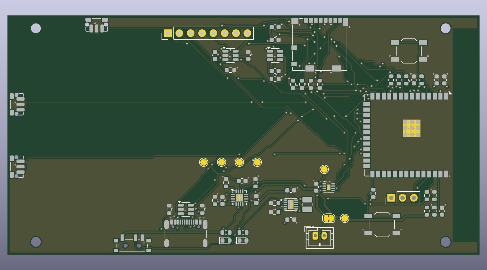

# Placa proprie v1 (CIORNĂ)

Placa cititorului care înlocuiește DevKit-ul și firele de pe masă: ESP32-S3,
încărcarea LiPo din USB-C, 3,3 V cu consum mic în somn, cardul și afișajul cu
alimentare comutată, trei butoane. Totul e **generat din script**: piesele și
legăturile sunt scrise o dată în `circuit.py`, din care ies schema, placa așezată
și trasată, verificările și fișierele pentru fabrică.

**E o ciornă.** N-a fost revizuită (PCB-4), nu s-a comandat, iar codurile LCSC
nu sunt verificate în catalog. Pașii PCB-1…3 din `docs/MASTER-PLAN.md` au acum o
primă variantă completă, cu trei luni înainte de calendar; prototipul de pe
DevKit rămâne referința până la măsurători.

## Cum se rulează

    hardware/pcb/make.sh                  # tot, ~2 min
    hardware/pcb/make.sh --fara-trasare   # doar verificările, fab/ și imaginile

Are nevoie de KiCad 10 (`kicad-cli` și modulul Python `pcbnew`), `cc` și `zip`.
`make.sh` se oprește dacă ERC-ul sau DRC-ul are vreo eroare, vreo legătură lipsă
sau vreo diferență între schemă și placă.

| fișier | ce face |
|---|---|
| `circuit.py` | sursa unică: piesele, valorile, amprentele, pinii pe rețele, codurile LCSC/MPN |
| `gen_sch.py` | schema `eink-reader-pcb.kicad_sch`, grupată pe blocuri, cu etichete globale |
| `gen_pcb.py` | placa: conturul, așezarea, rețelele, planurile, trasarea, umplerea zonelor |
| `route.py`, `astar.c` | trasorul (mai jos) |
| `project.py` | `.kicad_pro`: clasele de rețele și regulile |
| `eink-reader-pcb.kicad_dru` | regulile în plus (găurile butoanelor și ale mufei USB, traseele de putere) |
| `make.sh` | tot lanțul, cu verificările |

Ies: `build/` (rapoartele ERC/DRC în JSON, poziții, BOM brut, `cupru.svg`),
`fab/` (gerbere + găuri în `gerber.zip`, `bom.csv` și `cpl.csv` în formatul
JLCPCB) și `img/`. `build/` și `fab/` nu intră în git; se refac oricând.

Schema și placa se deschid normal în KiCad, dar **nu se editează de mână**: o
schimbare se face în `circuit.py` sau în așezarea din `gen_pcb.py` și se rulează
din nou `make.sh`.

## Placa

- 105,79 × 53,80 mm, exact placa modulului de afișaj WeAct de 3,7 țoli, cu
  găurile de M2 în aceleași locuri: cele două stau spate în spate, cu
  distanțiere.
- 4 straturi (procesul JLCPCB): F.Cu semnale, In1.Cu plan GND întreg, In2.Cu
  plan +3V3, B.Cu semnale. Pe F.Cu și B.Cu, GND turnat în rest.
- Trasee și spații de 0,15 mm (procesul permite 0,1), via 0,6/0,3 mm.
  Rețelele de putere (VBUS, VSYS, VBAT, BAT_J, LX1, LX2, 3V3_SD, 3V3_EPD) au
  0,4 mm, cu 0,25 mm admis unde nu încape altfel (mai jos).
- Antena modulului ESP32 e pe marginea din dreapta; pe ultimii 6 mm ai plăcii
  (zona interzisă din amprenta modulului) nu e cupru pe niciun strat.

## Piesele

Codurile LCSC sunt **de verificat** toate în catalog înainte de comandă (PCB-5);
unde lipsesc, piesa se alege atunci sau se lipește de mână.

| bloc | piese | de ce |
|---|---|---|
| USB-C | J1 GCT USB4105, R1/R2 5,1 kΩ pe CC, U1 USBLC6-2SC6 (LCSC C7519), R17/R18 divizor VBUS → IO2 | 5 V de la orice încărcător C; ESD pe D+/D−; firmware-ul vede când e cablul pus |
| încărcătorul | U2 BQ24074 (VQFN-16), R3 3,3 kΩ (ILIM ≈ 0,47 A), R4 1,8 kΩ (ICHG ≈ 0,5 A), R5 10 kΩ pe TS, D1/D2 PGOOD/CHG | power-path: dispozitivul merge din USB cu bateria goală; EN1/EN2 legați pentru USB500 |
| bateria | J2 JST-PH 2 pini, JP1 punte de lipit (I_BAT), U6 MAX17048 (indicator ModelGauge, I2C), R15/R16 1 MΩ divizor VBAT → IO1 | JP1 tăiată = un ampermetru în serie cu bateria, pentru E3/E4 |
| 3,3 V | SW1 PCM12 (comutator pornit/oprit pe EN), U3 TPS63900 buck-boost, L1 2,2 µH, R8/R9 configurarea | 75 nA în gol și buck-boost: 3,3 V stabil de la 4,2 V până la 2,5 V din baterie |
| comutatoare de sarcină | U4/U5 TPS22917 pentru card (3V3_SD) și afișaj (3V3_EPD), C7/C8 1 nF urcare lentă, R10/R11 1 MΩ pe EN | cardul și panoul nu consumă nimic în somn |
| MCU | U7 ESP32-S3-WROOM-1-N16R8 (C2913202), RC pe EN, SW5 BOOT, SW6 RESET, J5 UART0 | același modul ca pe DevKit, deci aceeași hartă de pini |
| butoane | SW2–SW4 Alps SKRTLAE010 (C110293), pe margini (două pe stânga, MENIU sus), apăsate din lateral | ÎNAPOI, ÎNAINTE, MENIU |
| afișaj | J3 baretă 1×8 de 2,54 mm spre modulul WeAct | BUSY, RST, DC, CS, SCK, MOSI, GND, 3V3_EPD |
| card | J4 Molex 104031 microSD, R21–R24 47 kΩ | modul SPI; pull-up pe CS, MISO și DAT1/DAT2 |
| test | TP1–TP6: VBUS, VSYS, BAT_J, VBAT, +3V3, GND | pentru punerea în funcțiune și măsurători |

GPIO-urile păstrează harta de pe DevKit (`firmware/boards/include/board_devkit.h`); în plus:
I2C pe IO16 (SDA) și IO17 (SCL), FG_ALRT pe IO7, SD_PWR_EN pe IO15,
EPD_PWR_EN pe IO21, VBUS_SENSE pe IO2.

## Consumul în somn (estimat)

| piesa | curent |
|---|---:|
| ESP32-S3 în somn adânc, cu temporizatorul RTC | ~8 µA |
| BQ24074, din baterie, fără USB | 4,3 µA |
| MAX17048 în hibernare | 3 µA |
| divizorul VBAT (2 MΩ la ~4 V) | 2,1 µA |
| TPS63900 în gol | ~0,1 µA |
| cardul și afișajul (comutatoarele oprite) | ~0 |
| **total** | **~17,5 µA** |

Cifrele sunt din foile de catalog (tipice). Cu o baterie de 1500 mAh, somnul
singur ar ține ani; consumul real e dat de paginile întoarse și se măsoară la
E3/E4, cu JP1 tăiată.

## Trasorul

KiCad nu are un trasor automat, iar FreeRouting cere Java și o rundă de
import/export. `route.py` e un trasor propriu, pe grilă, cu căutarea în C
(`astar.c`, prin ctypes):

- Grilă de 0,125 mm pe F.Cu și B.Cu, câte o matrice pe clasă de lățime (0,15 / 0,25 / 0,4 mm, via). Pentru fiecare rețea, cuprul celorlalte e
  umflat cu jumătatea lățimii pistei plus distanța minimă și scos din grilă,
  deci ce găsește A* respectă DRC-ul prin construcție.
- A* cu euristică octilă, via cu cost, B.Cu puțin mai scump (rămâne loc pentru turnarea GND). O rețea
  cu mai mulți pini crește ca un arbore: fiecare pin nou caută cel mai apropiat
  punct al arborelui de până acum.
- Pinii SMD de pe GND și +3V3 primesc o scurtă ieșire spre o via în planul lor.
- **Smulgere și retrasare** (în felul PathFinder): după 6 treceri complete în
  ordini diferite, o rețea care nu încape se caută din nou „moale”, având voie
  să treacă peste cuprul altora cu un cost mare. Rețelele atinse de drumul găsit
  se smulg, ea se trasează, apoi ele se retrasează. Celulele disputate primesc
  un cost istoric care crește, ca rețelele să nu se smulgă una pe alta la
  nesfârșit.

Rezultatul, pe placa de acum: **48 din 48 de rețele trasate**, 0 ieșiri spre
plan eșuate, după 15 smulgeri. 1.046 de segmente, 1.414,9 mm de pistă, 201 via.

## Verificările

`make.sh`, pe placa din git:

- ERC: 0.
- DRC (regulile din `.kicad_pro` și `.kicad_dru`, cu zonele reumplute): 0
  erori, 0 legături lipsă, 0 diferențe între schemă și placă.
- 4 avertismente `lib_footprint_mismatch` (U2, U3, U7, SW1): amprentele diferă
  de biblioteca KiCad dinadins. La U2 și U3 viaurile termice din padul central
  sunt mărite la găuri de 0,3 mm (minimul fabricii) și rărite. La U7 curtea e
  tăiată la marginea plăcii, unde iese antena. La SW1 serigrafia de peste
  margine e scoasă.

Pistele de putere de 0,25 mm (unde 0,4 nu încape):

| rețea | lățime | lungime | curent |
|---|---|---:|---|
| LX2 | 0,25 mm | 4,6 mm | nodul de comutație al TPS63900, sub 0,5 A |
| VBUS | 0,25 mm | 71,7 mm | 32,9 mm în blocul de alimentare (≤ 0,47 A, ~30 mV cădere), 38,8 mm spre divizorul R17 (µA) |

O pistă de 0,25 mm în cupru de 1 oz duce ~1 A la o încălzire de 10 °C, deci
are rezervă de două ori. Celelalte rețele de putere sunt de 0,4 mm: 3V3_EPD
5,9 mm, 3V3_SD 29,8 mm, BAT_J 13,8 mm, LX1 1,7 mm, VBAT 51,9 mm, VSYS 57,9 mm.

## De știut înainte de comandă

- **Poziția baretei J3** e luată din desenul modulului WeAct. Se măsoară pe
  modulul adevărat înainte de comandă.
- **Polaritatea JST** nu e standard: pinul 1 e plusul aici, dar cablurile
  bateriilor vin în ambele feluri. Se verifică cu multimetrul înainte de prima
  conectare.
- **Alimentarea inversă**: înainte de a opri 3V3_SD sau 3V3_EPD, firmware-ul
  trebuie să pună liniile SPI și CS-urile pe 0, altfel cardul sau panoul se
  alimentează prin diodele de protecție ale pinilor. Se scrie în
  `board_pcb_v1.h` (PCB-8).
- **TPS63900 la vârfurile de WiFi**: dă până la ~400 mA; ESP32-S3 cere vârfuri
  de ~350 mA la transmisie. Merge cu C5 + C14 (2 × 22 µF), dar fără rezervă.
  Cititorul nu folosește WiFi în mod normal; dacă va folosi, e de măsurat.
- **TS cu rezistor fix**: R5 îi spune încărcătorului că bateria are mereu
  25 °C, deci nu oprește încărcarea la cald sau la rece. Bateria trebuie să aibă
  protecția ei (PCM), ca toate celulele LiPo din comerț.
- **R8/R9** sunt alese din tabelele foii de catalog TPS63900 pentru 3,3 V; de
  reverificat la PCB-4.
- Contactul de detecție al cardului (J4) nu e folosit.
- J2, J3, J5 sunt cu găuri (THT); SW2–SW4 și J1 au picioare de fixare în găuri
  nemetalizate, cu reguli de distanță proprii în `.kicad_dru`.
- Etichetele pieselor sunt pe F.Fab, nu pe serigrafie: placa e plină, iar
  pozițiile se văd în `build/cupru.svg`.
- **Rotațiile din `cpl.csv`** trebuie verificate în previzualizarea JLCPCB:
  convențiile KiCad și JLCPCB diferă pentru unele capsule.
- Piesele fără cod LCSC: J1, U2, U3, U4/U5, U6, L1, R8/R9, C5/C14 (22 µF),
  J4. Se caută la comandă sau se lipesc de mână.
