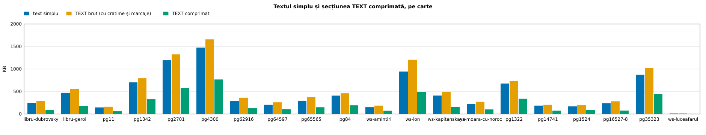

# E5: rezultate (partea de pe PC)

Două rulări: v2 din 2026-11-18, pe 20 de cărți, după [METODA.md](METODA.md) v2,
și v1 din 2026-11-17, pe 12 cărți. [tabele.md](tabele.md) și `date/` sunt ale
rulării v2, generate de `analiza.py`. Datele v1 sunt în commitul `5830012`. Lipsește partea
de pe dispozitiv (deschiderea, saltul la o poziție, decomprimarea unui bloc,
RAM-ul ocupat), care se măsoară pe prototip.

## Rularea v2 (2026-11-18): 20 de cărți

Cele 12 cărți de la v1 plus 8 noi (MEAS-1): Lermontov (FB2), *Hamlet*,
*Ulysses*, Creangă, Slavici, Rebreanu, Eminescu și Pușkin de pe Wikisource.
Proza are 14 cărți.

### Pe scurt

- **Mic, la fel ca la v1.** Secțiunea de text comprimată are 27–46 % din
  textul ei brut și 32–54 % din textul simplu. Patru cărți ies mai mari decât
  sursa: Creangă, Slavici și Rebreanu de pe Wikisource și Lermontov (FB2).
  Sursele lor sunt deja arhive, fără copertă și fără imagini, iar IBV le adaugă
  cratimele moi (de exemplu *Ion*: 379 KB EPUB, 486 KB IBV). Cartea cea mai
  lungă, *Ulysses* (1,4 MB de text simplu), are 780 KB.
- **Deschiderea în 4 KB la 16 din 20.** Excepțiile: Whitman (12,1 KB), Eminescu
  (9,0 KB), *Moby-Dick* (7,7 KB) și, nou, *Ulysses* (5,3 KB).
- **RAM mărginit.** Niciun bloc decomprimat nu trece de 32 KB, la nicio
  variantă și la nicio carte.
- **Conversia:** 0,04–3,49 s pe carte pe laptop. *Ulysses* e cea mai lentă.

### Predicțiile

| | predicția | v1 (12 cărți) | v2 (20 de cărți) |
|---|---|---|---|
| 1 | TEXT comprimat ≤ 50 % din brut, la proză | trece: cel mult 44 % | trece: cel mult 46 % (*Ulysses*) |
| 2 | cratimele moi adaugă ≤ 10 % la fișier | **nu trece**: 10,2 % | **nu trece**: 10,3 % la *Ion*, 10,2 % la *Țara mea*; celelalte 0,1–9,0 % |
| 3 | deschiderea în 4 KB la ≥ 3/4 din cărți | trece: 9 din 12 | trece: 16 din 20 |
| 4 | 32 KB câștigă < 5 %, 4 KB costă > 15 % | **nu trece**: −5,7 % / +15,5 % | **nu trece**: −5,7 % / +15,5 %, aceleași cifre pe 14 cărți |
| 5 | conversia < 5 s pe carte | trece: cel mult 1,67 s | trece: cel mult 3,49 s |

### Ce s-a schimbat față de v1

Nimic din concluzii. Corpusul aproape dublu confirmă aceleași praguri,
inclusiv pe cele două care nu trec. Predicția 2 greșește tot la limită și tot
pe proză românească: româna are cele mai multe cuvinte despărțite, iar cele
trei cărți românești noi în proză au 9,0–10,3 %. Rusa e aproape (8,0–8,7 %), engleza
mult sub (3,4–6,0 %).

Predicția 4 dă exact aceleași procente pe 14 cărți ca pe 8: raportul dintre
mărimile blocurilor e o proprietate a compresiei, nu a cărților alese.

*Ulysses* e singura carte nouă care nu se deschide în 4 KB, și e prima la care
nu doar cuprinsul e de vină. Are cuprinsul cel mai scurt dintre cele patru
excepții (87 de intrări, 2,5 KB), dar și cel mai mare index de blocuri
(111 blocuri, 2,6 KB). Indexul crește cu lungimea cărții. Cu propunerea de la
v1 (cuprinsul după indexul blocurilor, în formatul v0.2), deschiderea lui
*Ulysses* ar avea 2,8 KB și ar încăpea. O carte de două ori mai lungă n-ar mai
încăpea nici așa.

Cărțile de pe Wikisource n-au copertă, deci coloana „fără copertă” e 0 la ele.

## Rularea v1 (2026-11-17): 12 cărți

### Pe scurt

- **Mic.** Secțiunea de text comprimată are 27–46 % din textul ei brut, și
  32–52 % din textul simplu. Toate cărțile ies mai mici decât sursa, inclusiv
  EPUB-urile, care sunt deja arhive. Cartea cea mai lungă (*Moby-Dick*, 1,2 MB
  de text simplu) are 600 KB.
- **Se deschide ieftin.** La 9 din 12 cărți, tot ce trebuie pentru deschidere
  (antetul, directorul, metadatele, cuprinsul, indexul blocurilor) e în primii
  4 KB. Celelalte trei au cuprinsuri lungi: *Moby-Dick* (145 de intrări,
  7,7 KB), Eminescu (282, 9,0 KB) și Whitman (378, 12,1 KB).
- **RAM mărginit.** Niciun bloc decomprimat nu trece de limita formatului
  (32 KB), la nicio variantă. La blocurile implicite de 16 KB, cel mai mare are
  exact 16 KB.
- **Conversia e rapidă:** 0,23–1,67 s pe carte pe laptop.

### Predicțiile

| | predicția | rezultat |
|---|---|---|
| 1 | TEXT comprimat ≤ 50 % din brut, la proză | trece: cel mult 44 % |
| 2 | cratimele moi adaugă ≤ 10 % la fișier | **nu trece**, la limită: 10,2 % la *Țara mea* (Regina Maria). Celelalte cărți au 0,1–8,7 % |
| 3 | deschiderea în 4 KB la ≥ 9 din 12 | trece: 9 din 12. Dar excepțiile prezise erau două (Whitman, Eminescu), iar *Moby-Dick* e a treia |
| 4 | 32 KB câștigă < 5 %, 4 KB costă > 15 % | **nu trece**: 32 KB câștigă 5,7 % (4 KB costă 15,5 %, cum s-a prezis) |
| 5 | conversia < 5 s pe carte | trece: cel mult 1,67 s |

### Ce arată

**Compresia e partea care contează.** Fără ea, fișierul crește cu 109–263 %.
Coperta costă puțin (0,7–11 %, cel mai mult la cărțile scurte, unde e o
fracțiune mai mare).

**Cratimele moi costă cel mai mult în română.** Fiecare cratimă moale e
U+00AD, 2 octeți în UTF-8. În cărțile românești textul brut e cu 24–30 % mai
mare decât textul simplu (diferența vine mai ales din ele), iar după compresie diferența scade la 8–10 % din
fișier. În versuri, unde se despart puține cuvinte, costul e mic (0,1–2,3 %).
Prețul cumpără despărțirea făcută o singură dată, pe PC: dispozitivul nu are
nevoie de modele de despărțire și nu le aplică la fiecare paginare. E6 arată
că despărțirea e cel mai important factor pentru spațierea rândurilor.

**Mărimea blocului e un compromis, iar 16 KB rămâne implicit.** Blocuri mai
mari se comprimă mai bine (32 KB: −5,7 %). Dar orice salt la o poziție
citește un bloc întreg și îl decomprimă: la 32 KB se citesc de două ori mai
mulți octeți (mediana 12 KB față de 6,4 KB), iar RAM-ul pentru decomprimare se
dublează (32 KB față de 16 KB). Câștigul de 5,7 % înseamnă ~100 KB pe toate
cele 8 cărți în proză, nimic pe un card de câțiva GB. Predicția 4 a greșit
pragul, dar decizia rămâne. Cât costă de fapt un salt pe dispozitiv (citirea
de pe card + `tinfl`) se măsoară pe prototip și poate schimba balanța.

**Deschiderea.** Cuprinsul e cel care trece de 4 KB, nu indexul blocurilor.
Pentru cele trei cărți, deschiderea are nevoie de 2–4 citiri de 4 KB în loc
de una. La o magistrală SPI de 20 MHz, 4 KB se transferă în ~1,6 ms, deci
costul în plus e de câțiva ms; pe dispozitiv se măsoară. O îmbunătățire
posibilă în format (v0.2): cuprinsul pus după indexul blocurilor, ca
deschiderea să nu-l aștepte. Fără cuprins, și la cele trei cărți totul ar
încăpea în 4 KB (*Moby-Dick*: 2,2 KB).

## Reproducere

    (cd corpus && ./fetch.sh)
    python3 measurements/E5/run.py
    python3 measurements/E5/analiza.py

`date/versiune.txt` are commitul, versiunea Python, procesorul și sumele de
control ale surselor.
