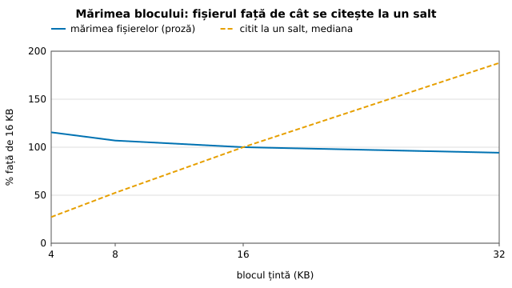

# E5: rezultate (partea de pe PC)

Rularea din 2026-11-17, după [METODA.md](METODA.md) v1. Cifrele vin din
[tabele.md](tabele.md), generat de `analiza.py` din `date/`. Lipsește partea
de pe dispozitiv (deschiderea, saltul la o poziție, decomprimarea unui bloc,
RAM-ul ocupat), care se măsoară pe prototip.

## Pe scurt

- **Mic.** Secțiunea de text comprimată are 27–46 % din textul ei brut, și
  32–52 % din textul simplu. Toate cărțile ies mai mici decât sursa, inclusiv
  EPUB-urile, care sunt deja arhive. Cartea cea mai lungă (*Moby-Dick*, 1,2 MB
  de text simplu) are 600 KB.
- **Se deschide ieftin.** La 9 din 12 cărți, tot ce trebuie pentru deschidere
  (antetul, directorul, metadatele, cuprinsul, indexul blocurilor) e în primii
  4 KB. Celelalte trei au cuprinsuri lungi: *Moby-Dick* (145 de intrări,
  7,7 KB), Eminescu (282, 9,0 KB) și Whitman (378, 12,1 KB).
- **RAM mărginit.** Niciun bloc decomprimat nu trece de limita formatului
  (32 KB), la nicio variantă. La blocurile implicite de 16 KB, cel mai mare are
  exact 16 KB.
- **Conversia e rapidă:** 0,23–1,67 s pe carte pe laptop.

## Predicțiile

| | predicția | rezultat |
|---|---|---|
| 1 | TEXT comprimat ≤ 50 % din brut, la proză | trece: cel mult 44 % |
| 2 | cratimele moi adaugă ≤ 10 % la fișier | **nu trece**, la limită: 10,2 % la *Țara mea* (Regina Maria). Celelalte cărți au 0,1–8,7 % |
| 3 | deschiderea în 4 KB la ≥ 9 din 12 | trece: 9 din 12. Dar excepțiile prezise erau două (Whitman, Eminescu), iar *Moby-Dick* e a treia |
| 4 | 32 KB câștigă < 5 %, 4 KB costă > 15 % | **nu trece**: 32 KB câștigă 5,7 % (4 KB costă 15,5 %, cum s-a prezis) |
| 5 | conversia < 5 s pe carte | trece: cel mult 1,67 s |

## Ce arată

**Compresia e partea care contează.** Fără ea, fișierul crește cu 109–263 %.
Coperta costă puțin (0,7–11 %, cel mai mult la cărțile scurte, unde e o
fracțiune mai mare).

**Cratimele moi costă cel mai mult în română.** Fiecare cratimă moale e
U+00AD, 2 octeți în UTF-8. În cărțile românești textul brut e cu 24–30 % mai
mare decât textul simplu (diferența vine mai ales din ele), iar după compresie diferența scade la 8–10 % din
fișier. În versuri, unde se despart puține cuvinte, costul e mic (0,1–2,3 %).
Prețul cumpără despărțirea făcută o singură dată, pe PC: dispozitivul nu are
nevoie de modele de despărțire și nu le aplică la fiecare paginare. E6 arată
că despărțirea e cel mai important factor pentru spațierea rândurilor.

**Mărimea blocului e un compromis, iar 16 KB rămâne implicit.** Blocuri mai
mari se comprimă mai bine (32 KB: −5,7 %). Dar orice salt la o poziție
citește un bloc întreg și îl decomprimă: la 32 KB se citesc de două ori mai
mulți octeți (mediana 12 KB față de 6,4 KB), iar RAM-ul pentru decomprimare se
dublează (32 KB față de 16 KB). Câștigul de 5,7 % înseamnă ~100 KB pe toate
cele 8 cărți în proză, nimic pe un card de câțiva GB. Predicția 4 a greșit
pragul, dar decizia rămâne. Cât costă de fapt un salt pe dispozitiv (citirea
de pe card + `tinfl`) se măsoară pe prototip și poate schimba balanța.

**Deschiderea.** Cuprinsul e cel care trece de 4 KB, nu indexul blocurilor.
Pentru cele trei cărți, deschiderea are nevoie de 2–4 citiri de 4 KB în loc
de una. La o magistrală SPI de 20 MHz, 4 KB se transferă în ~1,6 ms, deci
costul în plus e de câțiva ms; pe dispozitiv se măsoară. O îmbunătățire
posibilă în format (v0.2): cuprinsul pus după indexul blocurilor, ca
deschiderea să nu-l aștepte. Fără cuprins, și la cele trei cărți totul ar
încăpea în 4 KB (*Moby-Dick*: 2,2 KB).

## Reproducere

    (cd corpus && ./fetch.sh)
    python3 measurements/E5/run.py
    python3 measurements/E5/analiza.py

`date/versiune.txt` are commitul, versiunea Python, procesorul și sumele de
control ale surselor.
