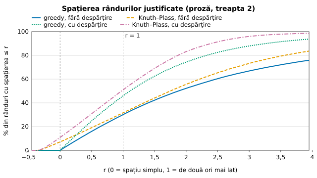
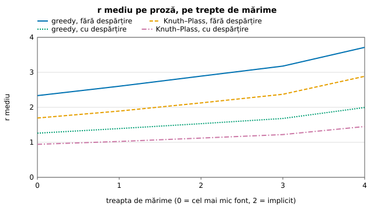

# E6: rezultate

Două rulări: v2 din 2026-11-18, pe 20 de cărți, după [METODA.md](METODA.md) v2,
și v1 din 2026-11-17, pe 12 cărți. [tabele.md](tabele.md) și `date/` sunt ale
rulării v2, generate de `analiza.py`. Datele v1 sunt în commitul `5830012`. Totul a rulat în
simulator, cu nucleul de paginare al firmware-ului și fonturile dispozitivului.
Timpul pe dispozitiv lipsește încă: vine din E2, pe prototip.

## Rularea v2 (2026-11-18): 20 de cărți

Proza are acum 14 cărți (6 în română, 3 în rusă, 5 în engleză), cu
~255.000 de rânduri justificate. Pe cele 12 cărți de la v1 paginarea e
identică: aceleași valori r pe fiecare carte.

### Pe scurt

Pe proză, la mărimea implicită, cu despărțirea pornită:

| | greedy | Knuth–Plass | schimbare |
|---|---:|---:|---:|
| r mediu | 1,53 | 1,13 | −26 % |
| r p95 | 4,32 | 2,86 | −34 % |
| rânduri cu r > 1 | 54,1 % | 49,0 % | |
| cratime consecutive / 1000 de rânduri | 57,5 | 29,2 | −49 % |
| pagini | 19.228 | 18.890 | −1,8 % |
| timp de paginare pe PC | 444 ms | 605 ms | ×1,36 |

### Predicțiile

| | predicția | v1 (8 cărți în proză) | v2 (14 cărți în proză) |
|---|---|---|---|
| 1 | K–P scade r mediu ≥ 15 % și r p95 ≥ 20 % | trece: −27 % / −34 % | trece: −26 % / −34 % |
| 2 | fără despărțire, r mediu ≥ 1,5×; K–P nu compensează | trece: ×1,89 / ×1,90 | trece: ×2,03 (greedy) / ×2,08 (K–P) |
| 3 | K–P are mai puține cratime consecutive | trece: 22,1 față de 47,6 | trece: 29,2 față de 57,5, dar nu la fiecare carte (mai jos) |
| 4 | spațierea e cea mai proastă la treapta 4 | trece | trece, la toate cele patru variante |
| 5 | K–P cel mult de 2 ori mai lent decât greedy pe PC | **nu trece**: ×2,32 | trece: ×1,36; vezi „Timpul” |

### Ce arată în plus

**Câștigul ține pe toate cărțile în proză.** r mediu scade cu 18–32 %, r p95 cu
24–48 %. Cele mai mari câștiguri sunt la *Капитанская дочка* (−32 %, −48 %),
care are și cea mai proastă spațiere la greedy (r p95 6,19). În afara prozei,
*Luceafărul* are −51 % / −75 %, dar acolo versurile nu se justifică și
rândurile măsurate sunt puține (notele și titlurile), deci cifra nu spune mult.

**Prima carte la care K–P pierde la cratime.** La *Капитанская дочка*, K–P lasă
mai multe cratime consecutive decât greedy: 168 față de 157 la 1000 de rânduri.
E și cartea la care K–P câștigă cel mai mult la spațiere: algoritmul
plătește spațierea cu cratime. Penalizarea pentru două cratime la rând e una
singură pentru toate limbile. Dacă rusa are nevoie de alta se vede doar cu un
cititor real, nu din cifre.

**Româna câștigă cel mai mult la cratime.** Pe cele trei cărți noi de pe
Wikisource: Creangă 76 → 7, Slavici 54 → 4, Rebreanu 95 → 17.

**Treptele de mărime** dau același tablou ca la v1. De la treapta 0 la 4, r
mediu crește de 1,5–1,7 ori la toate variantele.

**Timpul.** Predicția 5 trece acum (×1,36), deși la v1 nu trecea (×2,32), iar
codul de paginare e același. Rezultatul de paginare e identic pe cărțile vechi;
diferă doar timpul. Pe aceleași 8 cărți, greedy ține acum 218 ms (v1: 162),
iar K–P 296 ms (v1: 376). Ca să se vadă dacă e zgomot, cele două variante s-au
rulat alternativ de câte 5 ori (doar proza, treapta 2). K–P a ținut 603–627 ms,
greedy 440–454 ms: raportul a fost între 1,35 și 1,43 la fiecare pereche. v1 a
rulat dintr-un arbore cu modificări necomise, iar binarul `sim` a fost
recompilat după rularea ei, deci ce a cronometrat v1 nu se mai poate
reconstitui. Cifra v2 e cea reprodusă. Fără despărțire raportul e ×1,15
(v1: ×1,07). În absolut: 605 ms pentru 18.890 de pagini, ~32 µs pe pagină pe
PC. Pe dispozitiv rămâne de măsurat în E2.

## Rularea v1 (2026-11-17): 12 cărți

### Pe scurt

Pe proză (8 cărți, ~128.000 de rânduri justificate), la mărimea implicită, cu
despărțirea pornită:

| | greedy | Knuth–Plass | schimbare |
|---|---:|---:|---:|
| r mediu | 1,53 | 1,12 | −27 % |
| r p95 | 4,23 | 2,80 | −34 % |
| rânduri cu r > 1 | 55,3 % | 49,7 % | |
| cratime consecutive / 1000 de rânduri | 47,6 | 22,1 | −54 % |
| pagini | 9.755 | 9.579 | −1,8 % |
| timp de paginare pe PC | 162 ms | 376 ms | ×2,32 |

r e cât de lat iese spațiul dintre cuvinte într-un rând justificat față de un
spațiu simplu: 0 = la fel, 1 = de două ori mai lat.

### Predicțiile

| | predicția | rezultat |
|---|---|---|
| 1 | K–P scade r mediu ≥ 15 % și r p95 ≥ 20 % | trece: −27 % și −34 % |
| 2 | fără despărțire, r mediu de ≥ 1,5 ori mai mare; K–P nu compensează | trece: ×1,89 (greedy), ×1,90 (K–P) |
| 3 | K–P are mai puține cratime consecutive | trece: 22,1 față de 47,6 la 1000 de rânduri |
| 4 | spațierea e cea mai proastă la treapta 4 | trece, la toate cele patru variante |
| 5 | K–P cel mult de 2 ori mai lent decât greedy pe PC | **nu trece**: ×2,32 |

### Ce arată

**Încadrarea totală ajută, pe fiecare carte.** Toate cele 8 cărți în proză se
îmbunătățesc, cu 20–28 % la r mediu și 24–37 % la r p95. Și cărțile din afara
prozei se îmbunătățesc, cu o excepție la coadă: la Whitman (versuri lungi,
puține rânduri justificate) r p95 scade doar cu 8 %.

**Despărțirea contează mai mult decât algoritmul.** Greedy cu despărțire
(r 1,53) e mult mai bun decât Knuth–Plass fără despărțire (r 2,13). Cele două
împreună dau cel mai bun rezultat (1,12). Pe o coloană de 216 px, fără
despărțire, un cuvânt lung care nu încape lasă o gaură pe care nicio alegere a
rupturilor n-o mai poate umple.

**Cratimele consecutive scad la jumătate.** În cărțile românești scad cel mai
mult: Slavici 61 → 5, Caragiale 81 → 15, Regina Maria 97 → 18 la 1000 de
rânduri. Excepția e *Дубровский* (rusă, PT Serif): 166 → 114. Cuvintele
rusești sunt lungi, iar 38 % din rânduri se termină cu cratimă, deci rămân
multe perechi orice ar alege algoritmul.

**Rândurile strânse.** Knuth–Plass strânge 10,8 % din rânduri (r < 0, până la
−0,34). Greedy nu strânge niciodată. Strângerea
e motivul pentru care încap mai multe cuvinte pe rând și cartea are cu 1,8 %
mai puține pagini.

**Fontul mai mare strică spațierea, la toate variantele.** De la treapta 0 la
4, r mediu crește de 1,5–1,7 ori. Knuth–Plass cu despărțire la treapta 4
(1,45) e cam cât greedy cu despărțire la treapta 1 (1,39).

**Chiar și cu tot ce ajută, coloana e îngustă.** Și la cea mai bună variantă,
jumătate din rânduri au spațiile mai mult decât dublate. E limita unui ecran de
3,7″ cu text justificat. Opțiunea „Aliniere: la stânga” din setări rămâne
justificată de date.

**Timpul.** Predicția 5 nu trece: pe PC, Knuth–Plass ține de 2,32 ori cât
greedy (de la ×2,03 la ×2,64 pe carte). Fără despărțire, raportul e doar ×1,07:
costul vine din rupturile posibile în plus pe care le aduce despărțirea, nu din
algoritm în sine. În cifre absolute e mic: 376 ms pentru 9.579 de pagini, deci
~39 µs pe pagină pe PC. Pe ESP32-S3 (240 MHz) va fi de câteva zeci de ori mai
mult, dar paginarea rulează în fundal, între întoarceri. Cât costă de fapt se
vede în E2 (componenta „paginare”); dacă trece de 10 % din timpul întoarcerii,
se revine aici.

### Comparație cu cifrele de explorare

În timpul dezvoltării LAY-5 (2026-10-27), pe *Pride and Prejudice*: r mediu
1,57 → 1,14. Aici, cu LAYOUT_VERSION 4 (după verificarea cu TeX): 1,57 → 1,13.
Diferența de 0,01 e în limita schimbărilor făcute de atunci în motor.

## Reproducere

    (cd corpus && ./fetch.sh)
    (cd tools/fonttool && ./fetch-fonts.sh \
        && python3 fonttool.py family libron --sizes 15,16,17,18,20 -o out/fam \
        && python3 fonttool.py family ptserif --sizes 16,17,18,19,21 -o out/fam)
    measurements/E6/run.sh
    python3 measurements/E6/analiza.py

`date/versiune.txt` are commitul, compilatorul și sumele de control ale
cărților și fonturilor. Hash-urile paginării au fost identice la toate cele 5
rulări repetate.
